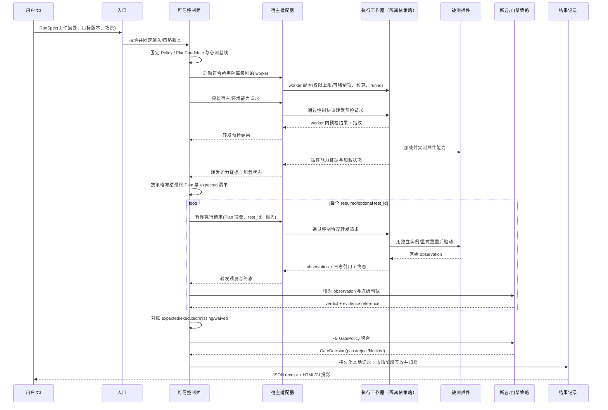
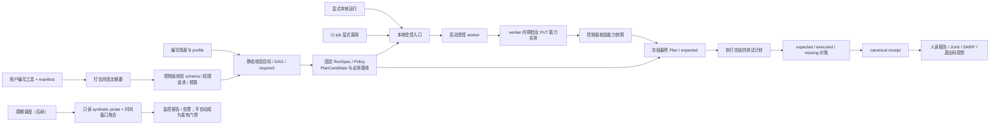
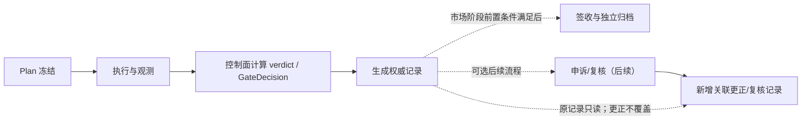
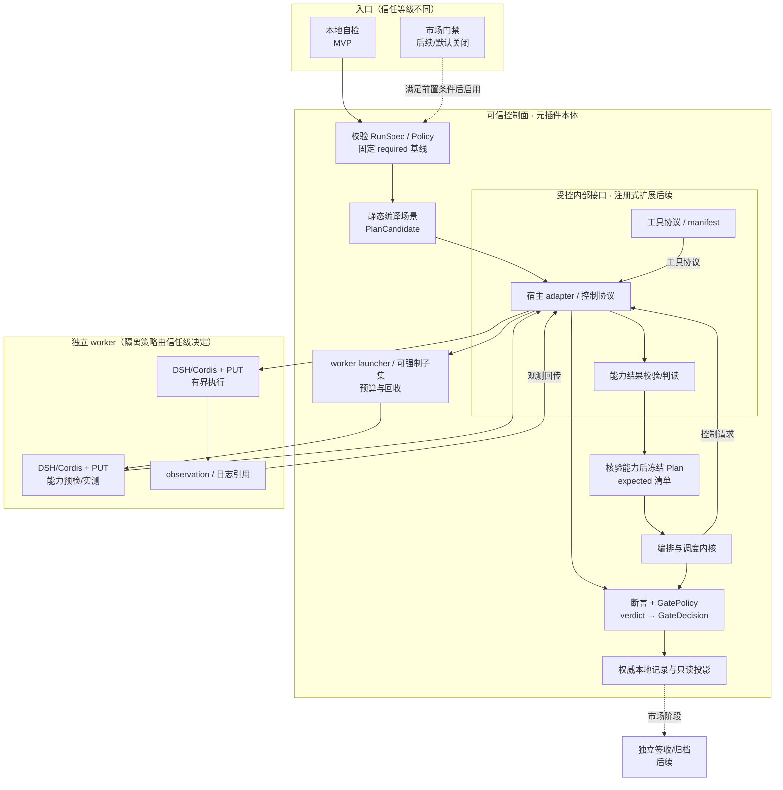
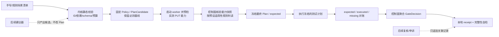

# DSH 插件测试平台 — 架构文档

- 状态：设计基线（MVP 已收敛；市场门禁为后续阶段）
- 日期：2026-10-16
- 范围：一个安装进 DSH（DeepSeek Harness）的「元插件」，用来验证其它 DSH 插件
- 文档性质：目标架构、信任边界和实施路线；未标记为「已实现」的内容不得视为现状保证
- 配套工件：`theory-proof.md`、`architecture.html`、`architecture.doc.html` 待生成/验收；在此之前不作为已验证依据

---

## 0. 当前结论与边界

本设计的首要目标不是一次性覆盖所有测试层，而是先建立一条**不漏跑、可复现、可审计**的最小闭环：固定一个 DSH/Cordis 版本，在独立的本地 worker 中对开发者自有 PUT 执行必测契约、加载/卸载和 smoke test，生成机器可读的 `expected / executed / missing` 结果。用户可按 §8.4 的版本化协议自制、组合本地基础测试工具；场景目录属于目标架构，不表示每种方法都已在 MVP 实现。首版本地进程隔离仅用于开发者自控环境中的预检，不提供针对恶意 PUT 或恶意工具的安全保证，也不构成市场安全边界。

以下边界是硬约束：

- `node:vm` 只提供行为隔离，不是安全边界；普通同权限子进程只提供崩溃和状态隔离，也不是市场级沙箱。
- 本地自检与市场门禁是两种信任等级，不承诺在不同环境中无条件得到同一结论。
- 市场门禁在强隔离、准入聚合规则、证据签收和包输入治理完成前保持关闭或仅用于非发布试运行。
- 本地 receipt 在没有外部信任锚时只能重算摘要并发现不匹配，不能宣称「不可篡改」或识别有意改写后同步重算摘要；最终门禁结果必须由控制面根据完整运行计划计算，不能由 PUT 或工作器自报。

## 1. 一句话定位

一个装进 DSH 里的 **元插件**，用 DSH 自己的机制去验证其它 DSH 插件——目标覆盖无宿主的单元逻辑、契约、集成、多插件冲突和端到端，并为未来的插件市场质量门禁保留一致协议；MVP 先交付单插件契约、加载/卸载和 smoke 闭环。全程由「可信内核 + 受控适配器」这一架构风格贯穿。

---

## 2. 背景与动机

DSH 的插件生态需要一个**统一的验证层**。当前痛点：

- 插件作者缺少一条从「纯函数能跑」到「在真实宿主里能和别人共存」的完整测试链；
- 插件市场的准入缺少**可复现、可审计、可检测篡改**的质量证据与明确的准入语义；
- 静态 API 目录与运行时行为契约尚未串成可执行、可对照的验证链。

本平台把这些需求收敛成一套分层、可组合、可扩展的测试能力，并用「确定性优先」保证同一个规格在**相同确定性配置与环境快照**下得到同一结论；对于网络、GPU、性能和真实外部系统等非确定因素，必须显式记录差异，不能作无条件一致性承诺。

---

## 3. 质量属性（目标层）

这是平台要达成的**目标**，不是实现细节：

| 属性 | 含义 |
|---|---|
| **准确性** | 必测项无静默漏跑；相同工件与确定性环境下可复现；证据来源、完整性及局限可核验 |
| **安全性** | 不受信 PUT 与控制面、密钥和归档隔离；隔离级别与发布权限匹配 |
| **通用性** | 先覆盖单一已锚定 DSH/Cordis 版本，再扩展多宿主、多版本和多插件矩阵 |
| **可组合** | 基础工具 → 小场景 → 大场景，组合受执行预算与覆盖策略约束 |
| **可扩展** | MVP 为宿主适配器、断言、能力探测器保留最小内部接口；可注册、独立发布仅在真实替换需求出现后评估 |

---

## 4. 设计原则（约束层）

上述目标靠下面的**纪律**落地：

| 原则 | 落地含义 |
|---|---|
| 判定精确 | 结果用显式 `verdict` 枚举（pass / fail / skip / error / inconclusive），无隐式「通过」 |
| 证据来源透明 | 每个判定绑定 observation 来源、验证方式与局限（静态检查 / mock / 真实宿主 / 记录重放）；不把来源标签解释成安全保证 |
| 规格先行 | 契约与场景先建模成可执行规格，断言与报告由规格生成，不从结果反推 |
| 对象安全 | 控制面与测试对象不共享可变对象，只走有版本、有大小上限的序列化消息；这不把普通子进程自动变成安全沙箱 |
| 并发与回收安全 | 用例不共享可变状态；MVP 明确 owner、超时、取消与幂等清理，后续并发调度再引入租约和围栏令牌 |
| 分层职责 | 五层各断言各的对象，不越层；断言只接收 observation，不直接操作 PUT 对象 |
| 确定性优先 | 固定工件、版本、环境快照、随机种子、时钟、区域、执行顺序和网络模式；非确定项显式标注 |
| 完整性可验证 | 报告带「应跑清单 / 已跑清单 / 缺口 / 免跑依据」，最终门禁由控制面计算 |
| 组合可验证 | 组合规则可静态校验；组合判定是成分判定与门禁策略的确定性函数，并受预算约束 |
| 最小信任 | 不信任插件自述、建议器输出和工作器自报；能力必须由工作器实测，包输入也必须先治理 |
| 版本可追溯 | RunSpec、Plan、PUT、DSH/Cordis、适配器、断言和报告 schema 都必须可寻址、可校验 |

### 架构风格：可信内核 + 受控适配器

目标风格是「可信内核定义稳定协议、受控适配器承接真实变体」。MVP 为编排、宿主适配、断言和能力探测保留最小内部接口，但每个接口只做一个内建实现；首版先打通「请求 → 本地 receipt」的纵向 smoke 闭环，不等同于 §6 第五层端到端测试。出现第二种真实实现/版本后，再决定是否把相应内部接口升级为稳定、可注册的扩展 SPI，避免预建注册生态或过度模块化。

### 拆分纪律

模块按 **职责边界 + 受信等级 + 变更频率** 切，不按文件大小切；依赖只指向内核或走依赖倒置，内部接口/未来 SPI 的实现不得反向依赖具体 PUT。宿主适配器、断言、能力探测器与稳定内核在代码职责上分离；可注册与独立发布须等待真实替换需求。

---

## 5. 形态与执行模型

### 5.1 形态

- **对外是单个插件**（一个安装入口），守住「装进 DSH 的插件」这一前提。
- **首版内部按代码模块分层**，不强制把每个模块做成独立 Cordis 子插件、独立版本或独立 fiber；只有生命周期、权限或部署确实需要隔离时再拆分。
- 插件包、执行 worker、控制面和报告工具可以分 package，但版本先由单一 release train 管理，减少组合兼容成本。

### 5.2 执行模型：控制面 + 工作器

平台插件作为 **控制面（orchestrator）**，负责输入校验、RunSpec/Plan 冻结、调度、聚合和证据签收；工作器负责装载 PUT、执行测试并回传原始观测。控制面与工作器只交换有 schema 版本、大小限制和 run-id 的序列化消息，不共享可变对象。

- PUT、其依赖包、安装脚本和生成代码一律视为不受信输入；依赖安装/构建若会执行代码，必须发生在工作器信任边界内，不能在控制面或持有签名密钥的进程执行。
- 工作器只提交 observation、执行状态与日志引用；不得持有控制面凭据、最终签名密钥或发布权限。最终 verdict 和 GateDecision 由控制面从冻结的 Plan 与已验证 observation 计算。
- 本地自检和市场门禁共享协议与测试规格，但隔离策略、可用能力、准入门槛和证据信任级别不同；不得因为同一规格就承诺两者无条件同结论。

### 5.3 隔离等级（与测试层正交）

隔离等级按**PUT 的信任级别**选择，不由测试层决定。即使是单元/契约测试，只要执行 PUT 代码，也必须受执行策略约束。

| 等级 | 机制 | 能力与边界 | 适用范围 |
|---|---|---|---|
| L0 行为隔离 | `node:vm`、mock、stub | 适合 API/行为测试；不防止逃逸，不提供宿主资源隔离 | 仅开发者自控环境中的本地自检，或已在更强隔离 worker 内再做二级隔离 |
| L1 故障隔离 | 普通子进程 | 隔离崩溃、堆和生命周期；若同用户/权限仍可访问文件、环境变量、网络和凭据，不是安全边界 | 开发者自控环境的本地调试；不得作为市场门禁隔离承诺 |
| L2 受限工作器 | 独立低权限身份、最小只读文件系统、独立临时目录、默认禁网/白名单、CPU/内存/进程数/时间限制、进程树清理 | 形成 OS 权限边界；配置与逃逸假设需由对抗测试验证 | 市场门禁的最低候选基线，须经安全验收后方可启用 |
| L3 强隔离执行 | rootless 容器、微型 VM 或专用远程 runner，凭据隔离、网络策略、镜像/runner 版本固定 | 更强的多租户隔离与可控环境；仍需补丁、运行时和宿主威胁模型 | 市场门禁优先目标及高风险插件 |

市场准入开放条件：至少 L2 经独立安全验收；高风险权限或多租户执行使用 L3。若当前部署不能满足该条件，只能标记为开发者自控环境中的本地自检或非发布试运行，不得描述为对不受信 PUT 安全。隔离配置必须随报告记录，不能仅记录“子进程”或“容器”名称。

---

## 6. 测试能力全景

**五层测试能力（隔离等级见 §5.3，二者正交）**：

1. **单元逻辑** — 测无宿主纯函数；若执行来自 PUT 的代码，仍按 PUT 信任等级选择工作器。
2. **契约** — 用 mock/stub 的 DSH API 校验参数、返回值和生命周期行为；静态目录不等同于行为保证。
3. **单插件集成** — 真实宿主中装载单个 PUT，验证装配、加载、运行和清理。
4. **多插件冲突检测** — 同一真实宿主运行多个插件，检查命令、钩子、文件、状态等冲突；首版只测明确 fixture，不默认穷举所有组合。
5. **端到端** — 真实宿主和受控外部能力跑通链路，需显式记录网络、外部服务和性能容差。

### 6.1 门禁聚合策略

单项 `verdict` 与最终发布 `GateDecision` 分开建模。控制面在启动 worker、加载 PUT 前固定版本化 `GatePolicy`、候选 `required/optional` 基线、允许的 `not-applicable` 适用性谓词及豁免规则；能力探测只为这些预定谓词提供经核验的输入。在首条测试请求前冻结最终 `Plan` 的 `required / optional / not-applicable` 分类，随后只按冻结的 `expected` 对账，禁止从已返回结果反推“应跑清单”或把必测项降为可选项。

| 单项结果 | 必测项的门禁影响 | 可选项的门禁影响 |
|---|---|---|
| `pass` | 满足该项 | 满足该项 |
| `fail` | `reject` | 报告质量缺陷；默认不改变 GateDecision，冻结策略可另行规定 |
| `error` | `blocked`，不得发布 | 报告错误，不自动视为通过 |
| `inconclusive` | `blocked`，不得发布 | 标记未决，不计作通过 |
| `skip` | `blocked`，除非执行前已审批有效豁免 | 中性，但须留缺口记录 |
| 未执行 / 无结果 | `blocked` | 报告为未执行 |

门禁不变量：

```text
missing = expected - executed_terminal - valid_preapproved_waived
missing_required = expected_required - executed_terminal - valid_preapproved_waived_required
missing_required 非空、或存在未豁免的 required fail/skip/error/inconclusive => GateDecision != pass
```

聚合优先级固定为：任何必测项缺失或存在未豁免的 required `skip/error/inconclusive` 时为 `blocked`；否则只要存在 required `fail` 即为 `reject`；全部未经豁免的 required 项均 `pass` 且至少有一项实际执行时才为 `pass`。optional 项的失败、缺失或未决状态须报告，但默认不改变 GateDecision，除非冻结策略另有要求。

上式的解释与实施约束：

- **计划与对账**：`expected` 包含冻结后的 required/optional 用例，不含有明确策略依据的 `not-applicable`。`executed_terminal` 仅指经控制面验证、已记录终态的用例；有可核验调度事件的执行前 `skipped/cancelled` 也可完成对账，但不证明工具逻辑实际启动。
- **实际启动证据**：每次 attempt 独立记录 `invocation_status = not-started | started | unknown`。仅凭控制面可核验的调用开始事件才记 `started` 与 `started_at`；派发请求或 worker 自报时间戳均不足以证明，无法核实时记 `unknown`，不猜为 `not-started`。
- **适用性与豁免**：`not-applicable` 必须在 `PlanCandidate` 中有预定义谓词，并在控制面核验能力快照后、最终 `Plan` 冻结前求值及留痕；能力未知或核验失败不得据此排除用例，也不等于执行时临时 skip。豁免保留范围、理由、批准者、有效期和策略版本；被豁免项保留在原始应跑基线和最终 receipt 中，不得伪装为已执行 `pass`。MVP 不接受运行时豁免；执行前批准/豁免工作流属于后续阶段。
- **最低通过条件**：零必测项、空计划或缺失报告均默认 `blocked`；`pass` 至少要求一个未经豁免的 required 项有控制面核验的 `invocation_status=started` 且 `verdict=pass`，并且所有未经豁免的 required 项均为 `pass`。`local usable`（技术上可运行）与 `market eligible`（满足发布策略及外部前置条件）是两个独立状态。

**两横切维度**：

- **周期验证**：回归 / 性能 / 安全属于执行计划维度；MVP 显式触发，定时调度在租约、取消、回收与并发限额验收后再启用。
- **通用质量手段**：覆盖率 / 模糊测试 / 属性测试，作为手段套用到各层。

> 覆盖率边界：行列/分支覆盖要求可插桩或源码可读；纯二进制黑盒插件只能做行为/接口覆盖。

### 6.2 场景分类与正交维度

五层表示**执行深度**，不是所有测试需求的分类枚举。TDD、CI、回归和在线监控描述触发或选择方式；性能、安全和兼容性描述质量目的；探索式、混沌和攻击测试描述执行方法或风险。因此场景必须使用可扩展的正交标签，而不是把这些概念塞进一个 `category` 字段：

| 维度 | 规范字段 | 首版允许的典型值 | 约束 |
|---|---|---|---|
| 执行层级 | `test_level` | `component`（含 unit）、`component-integration`、`system`、`system-integration`、`acceptance` | 只描述被测边界；contract 不是独立测试层 |
| 质量目的/类型 | `test_type` | `functional`、`non-functional`、`security`、`performance`、`compatibility`、`diagnostic`、`change-related`、`observability` | 可多选；插件可用命名空间扩展值 |
| 技术/方法 | `test_technique` | `contract`、`static-analysis`、`differential`、`property-based`、`fuzz`、`exploratory`、`fault-injection`、`attack` | 不同于 test level、tool role 和结果状态 |
| 触发/节奏 | `trigger` | `manual`、`tdd`、`pre-commit`、`ci`、`release`、`scheduled`、`incident` | CI 是编排入口，不是测试类型 |
| 套件选择 | `suite_profile` | `smoke`、`regression`、`e2e`、`compatibility-matrix`、`online-synthetic` | profile 选择用例和基线，不创建新测试层 |
| 目标 | `target_kind` | `source`、`package`、`plugin`、`api`、`service`、`system`、`external-owned` | 每个 live/active 目标必须有范围和所有权声明 |
| 执行模式 | `execution_mode` | `offline`、`mock`、`replay`、`live-readonly`、`live-active` | 只能根据目标策略授予；不降低工具或 PUT 的隔离等级 |
| 可重复性 | `repeatability` | `deterministic`、`seeded`、`environment-bound`、`best-effort` | 性能、外部系统和探索性检查均需记录限制 |
| 证据形态 | `evidence_kind` | `assertion`、`metric`、`finding`、`trace`、`log`、`artifact`、`session` | 证据形态不等于 verdict |

按职责复用基础能力，而不是按场景复制：worker 侧的 `fixture/provider` 提供受控输入，`probe/runner` 执行或观察，`transform/normalizer` 规范化输出；可信控制面负责 `assertion`、`baseline/comparator`、`reporter/exporter`、`scheduler` 与监控窗口聚合。两侧只通过带 schema 的观测/数据引用衔接。用户工具可有多个场景标签，但可执行代码只能拥有 manifest 请求且由 launcher 实际授予的能力。

| 用户需求 | 推荐标签/预设 | 可组合的基础工具链 | 默认边界与门禁语义 |
|---|---|---|---|
| 单元测试、TDD | `test_level=component`；`test_type=functional`；`trigger=tdd/pre-commit` | fixture → unit runner → assertion | 快速反馈；TDD 是反馈循环，不是新测试层 |
| 调试自检 | `test_level=component`；`test_type=diagnostic`；`trigger=manual/incident` | health probe → diagnostic assertion → bounded trace | 仅开发者自控环境；不得把自检日志当市场证据 |
| 静态检查 | `target_kind=source/package`；`test_technique=static-analysis` | source analyzer → finding normalizer → assertion/exporter | 解析器也在 worker 执行；静态工具不因“只读”而自动可信 |
| CI 自动化 | `trigger=ci` 的 suite/profile | selector → scenario compiler → runner → receipt/exit exporter | CI 是触发和结果集成；退出码由版本化 profile 定义 |
| API 与契约测试 | `test_technique=contract`；`test_level=component-integration/system`；`execution_mode=mock/live-readonly` | fixture/mock 或 allowlisted client → schema/diff probe → assertion | mock 与真实 API 必须分别标注；live 网络需显式 allowlist |
| smoke 与回归 | MVP：`suite_profile=smoke`；后续：`regression` + 版本化 `baseline_ref` | suite selector → smoke runner；后续增加 baseline comparator → assertion | MVP 仅支持 smoke；回归门禁待 §9.4 中 baseline 契约定义并验收，不能只凭 `baseline_ref` 声明启用 |
| E2E | `test_level=system/system-integration`；`suite_profile=e2e` | fixture/environment → workflow driver → observation → assertion | 受控外部系统、超时和清理必须可追踪 |
| 性能测试 | `test_type=performance`；固定 workload | workload generator → benchmark/metrics collector → tolerance/baseline assertion | 记录环境指纹、样本、容差和噪声；不宣称绝对性能 |
| 安全测试 | `test_type=security`；`test_technique=static-analysis/attack` | analyzer/probe → finding normalizer → severity/policy assertion | active 默认关闭；授权、范围、速率、影响上限和 kill switch 必须存在 |
| 兼容性测试 | `test_type=compatibility`；`suite_profile=compatibility-matrix` | matrix expander → same scenario per pinned environment → comparator | 每个 DSH/Cordis/Node/OS 组合独立 receipt，不用模糊兼容范围替代实测 |
| 在线验证与监控 | `test_type=observability`；`suite_profile=online-synthetic`；`execution_mode=live-readonly` | scheduler → synthetic probe → window aggregator → alert/report exporter | 时间窗口观测默认不改变发布 GateDecision；调度待租约和回收验收后启用 |
| 探索式测试 | `test_technique=exploratory`；`evidence_kind=session` | session driver → notes/trace/finding collector → optional assertion | 无明确判据时不得伪造确定性 pass；应报告 session 范围和未覆盖区域 |
| 混沌工程 | `test_technique=fault-injection`；`execution_mode=live-active` | owned fixture → fault injector → guard/abort monitor → resilience assertion | 默认关闭；目标所有权、维护窗口、影响预算、回滚和 kill switch 必须显式 |
| 攻击测试 | `test_type=security`；`test_technique=attack`；`execution_mode=live-active` | authorized target fixture → attack probe → evidence collector → security assertion | 只允许明确授权目标；不受控的公网或生产目标不能进入 Plan |

模糊测试、属性测试和覆盖率是跨层手段：编译器必须把有界的生成批次或会话展开成稳定 `test_id`，或将其作为带样本/预算的单一 test case；覆盖率和原始样本只能作为 observation，不能替代 required assertion。未知能力、外部不稳定和超出容差统一保留为 `inconclusive`/`blocked`，不隐式转成 `pass`。

---

## 7. 核心模块划分（逻辑边界，不要求九个子插件）

| # | 模块 | 职责 | 首版落点 / 信任边界 |
|---|---|---|---|
| 1 | **编排内核** | RunSpec/Plan 校验、场景调度、expected/executed 对账、GateDecision 聚合 | 可信控制面，MVP 必需 |
| 2 | **宿主适配器**（内部接口） | 控制面侧启动/停止工作器、序列化通信与能力声明；不得自身执行 PUT | MVP 一个本地实现；后续有真实第二种实现时再考虑可注册 SPI |
| 3 | **断言**（内部接口） | observation + 判据 → verdict + 证据引用；与工具的“做/观察”分离 | 可信控制面，MVP 规则实现；外部 SPI 后续按需 |
| 4 | **能力探测器**（内部接口） | 宿主/环境预检与工作器内 PUT 能力实测 | MVP 有限集合，记录未知状态；注册式扩展后续按需 |
| 5 | **工具规范** + SDK/适配器 | 工具 manifest、调用协议与 schema | MVP 使用最小内建协议；SDK 后续 |
| 6 | **组合建议器** + 人工把关 | 产出候选组合；只生成草案，不修改已冻结 Plan | MVP 手写/规则场景；建议器与人工批准后续 |
| 7 | **隔离工作宿主运行时** | 在对应信任等级下装载 PUT、执行与回传观测 | 与控制面独立部署；隔离等级见 §5.3 |
| 8 | **结果模型** | 结构化证据、签收/归档与只读报告投影 | MVP JSON，签名与归档在市场阶段验收 |
| 9 | **对外双入口** | 本地自检与市场门禁；共协议、不共准入权 | MVP 本地自检；市场入口默认关闭 |

首版按这些职责和最小内部接口拆分代码即可，不建设第三方注册机制。宿主适配器是**控制面接口**，工作宿主运行时是**worker 内实现**；两者不得合并为共享权限的同进程组件。只有出现真实替换需求后，才把相应内部接口升级成有版本和兼容策略的可注册 SPI；任何实现都不反向依赖具体 PUT。

---

## 8. 最小内部接口与后续扩展 SPI

### 8.1 宿主适配器（MVP 内部接口；注册式 adapter 后续）

- 适配器负责工作器生命周期和控制协议；隔离是 worker launcher/runtime 的安全属性，不可由接口名推定。
- MVP 仅一个本地 worker adapter，用于开发者自有 PUT 的受控本地自检；PUT 代码及依赖仍按不受信输入处理，但普通同权限子进程至多提供 L1 故障隔离，不得声称其满足市场门禁的 L2 安全要求。
- 容器/微型 VM/远程 runner 是后续实现，满足 §5.3 的能力与验收标准后才可注册为市场级 adapter。
- 宿主集成只依赖锁定 DSH/Cordis 版本中已核实的 API；本次核对基线见 §13。该 checkout 已包含 [`@deepseek-ai/dsh-cordis-host-runner`](../deepseek-harness/packages/extensions/cordis-host-runner/README.zh.md)（动态 Cordis 包注册与 Host 半生命周期）及 [`@deepseek-ai/dsh-tool-cordis`](../deepseek-harness/packages/extensions/tool-cordis/README.zh.md)（只读运行时检查，使用 runner 提供的 `ctx.cordisInspect`）。
- 这些现有运行时功能不等于隔离测试 worker、`test-tool/v1` 执行协议或市场级 launcher，不能直接替代测试 adapter。MVP 测试 adapter/launcher 仍须按本设计实现，并用锁定版本的生命周期契约测试核实；现有 runner 的 `node:vm` 沙箱也不是安全边界。

### 8.2 断言（MVP 内部接口，不是工具子类）

- 工具负责「做/观察」，产出 **observation**；可信断言只读取冻结的 observation 与判据，产出 **verdict + 证据引用 + 判据版本**。
- 断言和最终 GatePolicy 运行在控制面；工作器不直接下发布结论。`evidence_grade` 记录来源与局限，不与历史表现相乘形成伪精确分数。
- 做与判分离：组合图里能分清「观测节点」与「判定节点」。MVP 通过内部接口隔离职责；注册式外部扩展与独立发布须在出现真实替换需求后另行设计。

### 8.3 能力探测器（MVP 内部接口；注册式扩展后续）

- **两阶段探测**：① 在 PUT 加载前，于目标 worker 内预检宿主/环境能力，形成 `PlanCandidate` 的候选能力记录；② 在同一 worker 内加载 PUT、读取声明并实测其插件能力。控制面验证能力快照后，才在第一条测试请求发出前冻结最终 `Plan` 与 `expected`；探测不得在运行中增删测试节点。测试运行期间的网络/GPU 等易漂移能力须在关键时点复核。
- 能力记录拆为 `claim = declared | not-declared`、`observed = present | absent | unknown` 和 `verification = corroborated | contradicted | not-run`；声明不是观测，也不自动升级为“已验证”。
- 宿主能力缓存仅在相同 DSH/Cordis commit、worker 镜像和探测器版本下复用；环境能力每次测，PUT 能力按工件摘要重新核实，缓存失效条件写入证据。
- 能力结果绑定探测时间、探测器版本、worker/环境指纹及 PUT 摘要；控制面环境的探测结果不得替代 worker 内结果。
- 能力缺失/未知时，只能依据冻结策略中预先声明的适用性谓词，并在能力快照得到控制面核验后标记 `not-applicable`；未知或未经核验不得排除用例。已进入最终 `Plan` 的用例若无法执行则记 `skip` 或 `inconclusive` 并留痕，**绝不产生假 pass/fail**。必测项的 skip/inconclusive 由 §6.1 阻断发布。

### 8.4 用户自制基础工具契约

用户可以为本地项目制造基础工具，但“可制造”不等于“可取得市场信任”。工具是受边界约束的 observation producer；它不能在控制面执行任意代码、修改冻结 Plan、增加 expected 项、声明 required、写入 verdict 或 GateDecision。MVP 的目标对象仍是 DSH 插件及其明确声明的 source/package/runtime/API 目标；通用外部系统只有在目标、权限和适配器均已批准时才可接入。

**8.4.1 Manifest、身份与能力**

每个工具由声明式 manifest 加一个已固定摘要的 runner artifact 组成。manifest 是输入声明，不是权限证明；launcher 必须在 worker 外部重新校验并报告可强制执行的权限，无法由 L1 强制的请求标记为 `unenforced`，市场级隔离须在启动前由外部边界落实。字段名为平台规范字段，未列出的扩展必须使用工具命名空间，避免与控制面字段同名：

| 字段 | 要求 | 语义 |
|---|---|---|
| `schema_version` | 必填 | manifest schema 版本，使用 `test-tool-manifest/v1` 命名空间；与调用 envelope 的 `protocol_version`（`test-tool/v1`）独立演进，主版本不兼容时拒绝加载 |
| `tool_id` / `tool_version` | 必填 | 稳定工具身份与语义版本；同一 ID 的破坏性变更必须升主版本 |
| `artifact_digest` | 必填 | runner、依赖锁定文件及生成入口的内容摘要；不可用浮动 tag 代替 |
| `role` / `tags` | 必填 | `probe`、`fixture`、`transform` 等受限观测职责和 §6.2 标签；基线比较、assertion、report/exporter 属于可信控制面，不作为用户工具运行 |
| `runner` | 必填 | 受批准的 adapter、入口协议和工件类型；不得直接接受 manifest 中的任意 shell 字符串 |
| `input_schema` / `observation_schema` | 必填 | 输入与每个 observation `value` 的版本化 JSON Schema；内联或内容寻址的本地 schema，禁止网络远程 `$ref`；协议 envelope 由平台协议 schema 校验，控制面分别校验两者 |
| `requires` | 必填 | 需要的宿主/目标能力；只用于候选筛选，不能把声明当作已观测能力 |
| `permissions` | 必填 | 文件、网络、子进程、设备和 secret 的最小请求；默认均为 none |
| `limits` | 必填 | deadline、CPU、内存、临时空间、进程数、输出/附件大小和重试上限 |
| `determinism` / `retry` | 必填 | `deterministic`、`seeded`、`environment-bound` 或 `best-effort`，以及重试是否安全、退避和幂等要求 |
| `evidence` / `compatibility` | 可选但推荐 | 证据类型、脱敏策略、支持的 DSH/Cordis/Node/OS 指纹范围 |

最小示例（字段值仅示意，不代表已有注册工具）：

```json
{
  "schema_version": "test-tool-manifest/v1",
  "tool_id": "example.api-contract",
  "tool_version": "1.0.0",
  "artifact_digest": "sha256:1111111111111111111111111111111111111111111111111111111111111111",
  "role": "probe",
  "tags": ["contract"],
  "runner": { "adapter": "local-worker-json", "entrypoint": "run" },
  "input_schema": { "$schema": "https://json-schema.org/draft/2020-12/schema", "$id": "urn:example:tool:api-contract:input:v1", "type": "object", "properties": { "fixture_ref": { "type": "string" } }, "required": ["fixture_ref"], "additionalProperties": false },
  "observation_schema": {
    "$schema": "https://json-schema.org/draft/2020-12/schema",
    "$id": "urn:example:tool:api-contract:observation:v1",
    "type": "object",
    "properties": {
      "status_code": { "type": "integer" },
      "body": { "type": "object", "properties": { "user_id": { "type": "string" } }, "required": ["user_id"], "additionalProperties": false }
    },
    "required": ["status_code", "body"],
    "additionalProperties": false
  },
  "requires": ["target:api", "network:allowlisted"],
  "permissions": { "filesystem": ["workspace:read"], "network": ["127.0.0.1:4001"], "subprocess": [], "devices": [], "secrets": [] },
  "limits": { "timeout_ms": 30000, "cpu_ms": 15000, "memory_mb": 256, "processes": 1, "temp_bytes": 8388608, "output_bytes": 1048576, "attachment_bytes": 1048576, "concurrency": 1 },
  "determinism": "environment-bound",
  "retry": { "safe": false, "max_attempts": 1 }
}
```

该示意 manifest 使用本地受控 API fixture，schema 内联且声明了网络目标；重复十六进制摘要仅用于展示格式，不对应实际工件；实现必须由打包器根据真实 runner、依赖锁定文件和入口计算 digest，不能把示例值提交为真实工件摘要。JSON Schema 固定 Draft 2020-12，校验须限制 schema 深度/大小并拒绝远程引用。

工具准入与逐次执行阶段由控制面记录，且与测试 verdict 分开：

| 阶段 | 含义 |
|---|---|
| `draft` | 用户正在编写，不能进入 Plan |
| `validated` | manifest、artifact、schema、权限请求和预算通过静态校验；尚不代表 OS 已强制权限 |
| `pinned` | 已解析到具体版本、摘要、adapter 和环境能力快照 |
| `prepared` | worker 已建立适用的运行目录和资源边界，但尚未开始工具逻辑 |
| `running` | 控制面已派发 request，仍在 deadline 内；不单凭派发推断工具逻辑已开始 |
| `completed` / `skipped` / `error` / `timeout` / `cancelled` | attempt 的执行终态；可来自有效 worker 消息或控制面事件，由控制面核对来源和 attempt 后采纳，不直接等同 `pass`、`fail` 或 GateDecision |
| `admission_status` | 独立字段，取值为 `accepted` 或 `rejected`；拒绝必须保留 reason code；该字段本身不充当 worker 终态或 verdict，冻结后拒绝的对账语义见下文 |

`draft/validated/pinned` 描述工具包准入，`prepared/running/终态` 描述单个 test case 的 attempt；`admission_status` 描述该 attempt 是否获准派发。工具/场景在最终 Plan 冻结前被拒绝时，run 记为 `blocked`，不得生成虚假的逐项执行终态；冻结后某 expected 项被拒绝时，记 `admission_status=rejected`、`execution_status=skipped`、`verdict=skip`、`reason_code=policy_rejected`、`invocation_status=not-started`，required 项按 §6.1 阻断。上述字段不代替 §9.5 独立的 `run_status`、`execution_status`、单项 `verdict` 与最终 `gate_decision`。

**8.4.2 版本化调用协议**

控制面向 worker 发送 `ToolRequest`，worker 只能返回 `ToolResponse`。消息 envelope 必须通过平台固定的 `test-tool/v1` schema，并包含 `request_id`（每个 dispatch 唯一）、`run_id`、`plan_id`、稳定 `test_id`、attempt、`tool_ref` 及有界的 payload。每个 response 必须 echo 此 correlation tuple；超时、重复、乱序、错配、未知字段/版本或迟到响应由控制面拒绝或按 reason code 记为错误。

```json
{
  "protocol_version": "test-tool/v1",
  "request_id": "req-20261016-001",
  "run_id": "run-20261016-001",
  "plan_id": "plan-sha256:6666666666666666666666666666666666666666666666666666666666666666",
  "test_id": "contract.login.schema",
  "attempt": 1,
  "tool_ref": { "tool_id": "example.api-contract", "version": "1.0.0", "artifact_digest": "sha256:1111111111111111111111111111111111111111111111111111111111111111" },
  "target_ref": { "kind": "api", "owner_put_digest": "sha256:3333333333333333333333333333333333333333333333333333333333333333", "origin": "http://127.0.0.1:4001" },
  "input": { "fixture_ref": "fixture://login/v1" },
  "deadline": "2026-10-16T04:30:00Z",
  "capability_snapshot_ref": "cap-sha256:4444444444444444444444444444444444444444444444444444444444444444"
}
```

```json
{
  "protocol_version": "test-tool/v1",
  "request_id": "req-20261016-001",
  "run_id": "run-20261016-001",
  "plan_id": "plan-sha256:6666666666666666666666666666666666666666666666666666666666666666",
  "test_id": "contract.login.schema",
  "attempt": 1,
  "tool_ref": { "tool_id": "example.api-contract", "version": "1.0.0", "artifact_digest": "sha256:1111111111111111111111111111111111111111111111111111111111111111" },
  "execution_status": "completed",
  "observations": [{
    "observation_id": "obs-001",
    "schema_ref": "urn:example:tool:api-contract:observation:v1",
    "value": { "status_code": 200, "body": { "user_id": "fixture-user-001" } },
    "source": "worker",
    "limitations": ["controlled-fixture"]
  }],
  "artifact_refs": [{ "kind": "log", "digest": "sha256:5555555555555555555555555555555555555555555555555555555555555555", "size_bytes": 412 }],
  "diagnostics": []
}
```

`ToolResponse` 必须回显请求中的 `request_id`、`run_id`、`plan_id`、`test_id`、attempt 和固定 `tool_ref`；控制面拒绝或隔离未知字段/版本、错配或重复 correlation tuple、超 deadline 的迟到响应，并将拒绝原因关联到该 attempt。平台协议 schema 校验 envelope，manifest 声明的 observation schema 校验每个 `observations[].value`，再核验 observation 与 artifact 数量/字节上限、引用归属及工具摘要。`ToolResponse` 不得携带权威 `verdict`、`GateDecision`、`required`、`expected` 或 Plan 修改。验证通过后 observation 才交给 §8.2 的断言。工具产生的 `finding` 是报告对象，不自动等于 required `fail`；是否影响门禁只能由冻结判据和 GatePolicy 决定。

**8.4.3 预算、权限与隔离**

工具及其依赖包和生成代码都按不受信输入处理，即使工具只读源码也必须在 worker 中运行。控制面冻结策略授予值与 manifest 请求值的交集，未授予的能力一律拒绝；launcher 在声称具备安全边界的隔离等级上必须由 OS/容器/微型 VM 的外部约束落实以下限制：

- 文件系统仅开放独立临时目录及授予的只读输入；控制面目录、密钥目录和任意宿主路径不可映射到 worker；
- 网络默认禁用；live API/监控/攻击工具仅开放冻结的主机/端口 allowlist 和维护窗口；不给 worker 注入 ambient credentials；
- CPU、内存、进程数、临时空间、输出/附件字节数、deadline、重试次数和并发数均有界；取消时回收整个进程树、端口和临时资源；
- 工具输出先限长、脱敏、摘要化，再形成 observation/artifact reference；日志不能改变权威结果；
- L0/L1 的参数校验或同权限进程检查**不能可靠限制恶意工具的文件/网络访问**，无法兑现的权限声明标记为 `unenforced`，只允许开发者自控的 local receipt。市场阶段须满足 §5.3 的 L2/L3、来源审查、权限/预算对抗验收、证据签收与归档，才能作 eligible 判定。

MVP 的本地接入路径：用户把工具代码、依赖锁定文件和 manifest 放在项目可读路径，打包器计算摘要；RunSpec 引用已固定的本地工件及 scenario/profile，控制面验证路径不逃逸指定工作区、拒绝未锁定依赖及不受控外部 schema，然后通过 `local-worker-json` 在 worker 内按 `ToolRequest`/`ToolResponse` 边界执行。若用户提交 CLI/脚本，只能由已批准的 adapter 以参数数组启动固定入口，禁止 shell 拼接；不得让脚本进入控制面。**MVP 普通同权限本地 worker 仅提供 L1 故障隔离，manifest 权限值不是 OS 强制边界**：除非用户另提供并验证外部沙箱，只能由开发者在自有、无秘密的隔离开发环境中显式运行自己信任的工具，且仅针对自有或获批目标；CI 同样只能使用开发者控制、专用且无秘密的 runner/job，执行进程和 worker 均不能接触 ambient credentials 或发布凭据，不能以 secret masking 代替隔离。结果必须标记 `local-only`，不能用于市场发布或宣称强隔离。无法强制执行的权限标记为 `unenforced`，依赖此能力的市场级运行须拒绝。用户至少自测正常输出、非法 schema、重复/乱序响应、超时、越权资源访问、目标不可用和取消/清理，再将结果纳入本地场景。独立 SDK、远程 runner、第三方注册表及市场级自定义工具属于后续能力；本文是接口目标，不声称已有实现。

---

## 9. 组合子系统

组合职责分为「可信内核 +（后续）不受信建议器 +（市场阶段）人工把关」；MVP 只实现可信内核和手写/规则场景清单：

### 9.1 组合内核（权威层）

RunSpec 描述固定输入、目标 DSH/Cordis、测试选择和策略版本；编排内核先生成不可删减的 `PlanCandidate`，完成 worker 能力探测并由控制面核验后，再生成最终不可变 `Plan`。首版只支持有限的静态场景清单；校验唯一 ID、依赖关系、输入/输出 schema、预算、能力谓词和门禁分类。最终 `Plan` 冻结后不得由建议器、PUT 或运行时探测修改。

### 9.2 建议器（延期）

MVP 使用手写/规则场景清单，不引入模型、学习闭环或在线组合推荐。后续建议器只能输出候选草案，须过内核静态校验与人工批准后形成新版本 RunSpec；它不参与 verdict 聚合，不得绕过 required 清单。

### 9.3 人工把关（范围受限）

本地场景维护由代码评审完成；市场阶段才引入带身份、理由、范围与有效期的豁免/批准记录。审批不得改写已冻结运行，也不得删除历史证据。

- 场景/策略/工具 schema 均版本化；运行记录精确绑定其版本与摘要，迁移生成新版本，不重写旧记录。
- 组合必须隔离档感知：跨 worker 只经有 schema、大小和预算限制的序列化消息桥接。
- 并发用例需独立工作目录、进程组/容器与配额；不得共享可变状态。

### 9.4 可组合场景图与静态编译

用户场景是版本化 `Scenario`，由 `ToolTask`、`AssertTask` 和显式 `Fixture/Target` 引用组成。场景图只描述要观察什么以及如何解释；它不能承载或绕过 GatePolicy。编译器先生成 `PlanCandidate`，完成能力探测后在第一条测试请求前生成最终冻结的 `Plan`、`expected` 清单和预算：

1. 在启动 worker 前固定场景版本、工具/runner/依赖摘要、目标引用、策略与 schema 版本；拒绝浮动 tag 和未锁定依赖，并为所有断言项生成不可删减的候选 `test_id` 基线。
2. 静态校验全局唯一 `node_id`/`test_id`、全部引用可解析、工具输入/输出 schema 兼容、能力谓词可解释、权限得到策略授予、每项与整张图均未超预算；不把尚未在 worker 核验的运行时能力误当作已满足。
3. 拒绝有向环、未绑定输入、跨权限域的直接对象引用、未授权目标和不支持的节点类型。边界间只传 schema 校验后的有限 JSON 值或内容寻址 artifact reference。
4. 在 worker 内执行预检、加载/实测 PUT 能力，并由控制面核验能力快照。只有冻结策略明确允许且能力已核验为不适用的候选项，才可从最终 `expected` 投影中标记 `not-applicable`；能力未知、声明自相矛盾或核验失败的项必须保留在 `expected`；随后无法执行时须记录带 reason code 的非通过终态，通常记为 `inconclusive`。若明确的策略拒绝导致未执行，可记为 `skip`，但 required 项仍按 §6.1 阻断；只有独立存在的有效预先批准豁免才能免除此阻断。
5. 在任何测试请求发出前冻结最终 `required/optional/not-applicable` 分类、expected outcome（如有）、attempt/retry 上限、预算和环境矩阵，产生不可变 `plan_id` 摘要，并记录每个节点的来源、工具 digest、数据依赖、权限和计划时间。MVP 禁止运行时动态发现的新用例；fuzz/property 批次须在 `PlanCandidate` 阶段有界展开，或明确定义为一项可复现的聚合用例。执行中不得增加、删除或改写计划节点。

依赖边分两类，禁止混用：

| 边类型 | 示例 | 语义 |
|---|---|---|
| `needs`（控制依赖） | `assert-login` 在 `probe-login` 之后 | 只保证先后顺序，不隐含数据传递。除非另有显式条件，前序失败本身不自动取消后续独立检查 |
| `inputs.<name> <- outputs.<name>`（数据依赖） | `assert-schema.input <- probe.response` | 编译时检查 schema；运行时只传校验后的序列化数据/摘要引用。必需输出缺失或无效时，下游节点记录 `skipped` 和 reason code，仍留在 expected，不得静默消失或 pass |

调度使用稳定拓扑序；同一就绪层以稳定 `node_id` 作为确定性 tie-break。只有无共享可变状态、无未仲裁外部副作用且累计资源仍在预算内的分支才可并发。可重试节点必须在冻结时声明幂等性和尝试预算；每次重试新增关联 attempt，不覆盖此前 observation/verdict。

MVP 的 `AssertTask` 仅允许受控内建断言 DSL（如 schema-valid、equals、contains、numeric-range、finding-count）；不执行用户任意断言代码。`baseline-delta` 与回归比较推迟到后续版本，待 baseline 工件 schema、来源/不可变摘要、容差归属、晋级策略和缺失/不兼容时的 fail-closed 行为定义并验收后再启用。用户工具可以产出原始 finding 和 measurement，但判据表达式由可信控制面解析并绑定版本；active 攻击、混沌和探索性节点另受 §6.2/§8.4 的目标授权与预算限制。

### 9.5 状态正规化与失败传播

运行状态、工具执行状态、用例 verdict 和 GateDecision 是不同字段，不可互相替代：

| 对象 | 平台枚举 | 产生者/语义 |
|---|---|---|
| `run_status` | `queued`、`running`、`completed`、`cancelled`、`blocked` | 控制面记录一次运行生命周期；`blocked` 表示 Plan 或运行前提不满足 |
| `admission_status` | `accepted`、`rejected` | 控制面记录是否准许派发；拒绝必须有 `reason_code`，不属于 worker response |
| `execution_status` | `completed`、`skipped`、`error`、`timeout`、`cancelled` | 控制面从有效 worker 消息或其自身可关联的调度/监控事件归一化；只有核验并记录的终态计入 `executed` |
| `invocation_status` | `not-started`、`started`、`unknown` | 控制面按可核验调用开始事件记录工具逻辑是否实际启动；派发请求和 worker 自报时间戳都不是证明 |
| `verdict` | `pass`、`fail`、`skip`、`error`、`inconclusive` | 控制面根据 observation、冻结 criteria 或受控终态产生；不属于工具 response 字段 |
| `gate_decision` | `pass`、`reject`、`blocked` | 控制面按冻结 GatePolicy 聚合，语义见 §6.1 |

`executed` 表示控制面已为冻结 Plan 项采纳一个终态记录，不表示工具逻辑确已启动；实际调用是否开始由逐 attempt 的 `invocation_status` 表示。工具包或场景在最终 Plan 冻结前被拒绝时，run 记为 `blocked` 且不伪造逐项终态；若冻结后某个已在 `expected` 中的 attempt 被拒绝，则按 §8.4.1 记录 `admission_status=rejected`、`execution_status=skipped`、`verdict=skip` 与拒绝原因，使 required 项 fail-closed。缺少 worker response、非法 schema、消息来源/attempt 不匹配或被拒绝的响应不得作为通过结果。若控制面有可关联的启动、依赖阻断、deadline、取消、进程退出或协议校验失败事件，可为该 `test_id/attempt` 生成有 `reason_code` 的 `skipped/error/timeout/cancelled` 终态和非通过 verdict；**不能重用 worker 自报的判定**。`invocation_status=not-started` 只适用于有证据证明启动前被阻止的情况；若无法证明是否启动则记录 `unknown`。若既无有效响应也无可验证的控制面终态，Plan 项仍由控制面对账为 `missing`。重试按冻结预算产生新 attempt、保留每次失败和所有终态；最终 verdict 由预先版本化的聚合规则计算，不能把先前失败抹去。required 项上的 `skip/error/inconclusive` 或缺项继续遵从 §6.1，不能由报告器或适配器改写。工具返回的 `finding` 可以与 verdict 同时存在；发现严重问题是否导致 `fail/reject` 必须由预先版本化的断言和门禁策略决定。

---

## 10. 双用户 · 双入口 · 两档信任

两个入口共享 RunSpec、Plan、worker 协议和 GatePolicy 解释器；在**相同工件、版本、环境快照和隔离等级**下，本地 `gate dry-run` 才能重算同一个门禁结果。不同环境导致的 `unknown / skip / inconclusive` 不得被本地结果掩盖。

| 入口 | 默认信任 | 作用 | 发布权限 |
|---|---|---|---|
| **本地自检** | PUT 可为开发者自有代码；结果是预检或复现材料 | 单插件、快反馈、允许开发者查看原始日志 | 无市场发布权限；可产生 unsigned/local receipt |
| **市场门禁** | PUT、依赖包和执行环境均不受信 | 运行完整 required Plan，产出可验证 receipt 和 GateDecision | 仅强隔离、策略聚合、证据签收及人工/自动批准全部通过后开放 |

门禁路径固定为：`intake → pin/verify artifact → freeze Policy/PlanCandidate → capability probe → freeze Plan → execute → reconcile expected/executed/missing → aggregate → persist local receipt → (market stage) sign/anchor receipt`。任一步必需步骤缺失都只能得到 `blocked` 或 `local-only`，不能得到发布 `pass`；MVP 不把尚未实现的签名/归档当作已具备能力。

本地 `GateDecision=pass` 只说明指定的本地 profile 通过；CI 若声明 market-required，必须检验收据 `trust_scope` 和市场适格性，`local-only`、无签收或无归档锚一律不能作为发布通过。出口码 profile 要区分本地验证与市场必需阶段，且不得把后者的本地 pass 映射成发布成功。

市场门禁的最低前置条件：

- worker 达到 §5.3 规定的市场级隔离并通过对抗验收；
- GatePolicy 对 required、`skip/error/inconclusive`、豁免和空计划有 fail-closed 规则；
- 控制面独立签收 observation，证据 receipt 能检测篡改且有独立归档/信任锚；
- PUT 包、依赖、构建结果和实际执行工件可追溯；失败可由相同输入复现。

在这些条件满足前，“市场门禁”按钮存在也只能用于非发布试运行。

---

## 11. 结果与证据模型

权威结果是**由可信控制面核对并持久化的结构化记录**，不是工作器日志或 HTML；本地自检可输出未签名的本地收据，但不能冒充市场级证据。

| 层 | 内容与约束 |
|---|---|
| **机器可读记录（MVP）** | `schema_version`、`run_id`、可得的 RunSpec/Policy/PlanCandidate 摘要、已冻结时的 Plan 摘要、PUT 工件与依赖锁定摘要、DSH/Cordis/worker/断言版本、环境与隔离配置、探测快照；Plan 已冻结时记录 `expected / executed / missing / waived`、逐项 observation 引用及 verdict，计划未形成则记录阶段与拒绝原因；最终 GateDecision；至少支持本地持久化与完整性自检 |
| **受信收据（市场阶段）** | 控制面验证序号、run-id、plan-id 与 worker 消息后计算 verdict；对规范化记录做摘要并由不在 worker 内的密钥签名；追加进只读归档并返回可验证的归档锚（时间、身份、算法、key-id、记录摘要） |
| **展示/导出面孔** | HTML、JUnit、TAP 是权威记录的只读投影；不得从导出格式回填或改变 verdict；缺字段须显式标注丢失信息 |

### 11.1 来源、完整性与局限

- 记录 `source = local | worker | control-plane | archive`、采集者身份、采集时点和可信边界。PUT 输出及 worker stdout 是**观测数据**，不是可信判决；签名只证明控制面收到并认可过记录，**不证明** PUT 没有恶意行为或运行环境绝对安全。
- 冻结 Plan 中的每项都有稳定 `test_id`、required/optional 分类和预期结果；`executed` 保存控制面采纳的终态及证据引用，仅表示该项已完成对账；逐 attempt 的 `invocation_status` 独立记录工具逻辑是否实际启动。`missing`（尤其 `missing_required`）由控制面以冻结的 expected 清单独立计算，并单独记录合法豁免；候选基线中未进入 expected 的 `not-applicable` 项也须留下谓词版本、核验快照与理由，确保不能静默删项。相同 `test_id` 的重试需要尝试序号与预算，不能覆盖前一次失败或静默把未跑项删掉。
- 日志、二进制和大工件只保存内容摘要 + 受控引用，设保留期、大小上限和敏感信息脱敏；若原始材料缺失，报告必须标记验证限制。
- 内容寻址、hash 链和 append-only **只能检测部分篡改**；市场级“不可事后改写”依赖独立归档、密钥管理与审计。删除、更正和申诉都产生新的关联记录，不能覆盖原判定。
- 复现分两级：记录重放仅验证聚合/报告；相同工件与固定环境重新执行可复测行为。外部网络、性能时序等非确定性结果仅在声明的容差/窗口内比较，不承诺逐字节相同。

### 11.2 标准术语与报告互操作

平台采用下面的**本系统规范术语**，并尽量与软件测试行业常用语对齐；这张表是字段和职责的唯一词汇表，插件不得用“结果”“状态”“报告”等含义不明的词替代它们。测试层级和测试类型可参考 [ISTQB Glossary](https://glossary.istqb.org/en_US/)，但本平台的字段、门禁和信任语义由本文件定义，不宣称继承外部标准的完整行为契约。

| 术语 | 规范定义 | 不得混淆 |
|---|---|---|
| `tool`（工具） | 有 manifest、版本和权限边界的 observation producer；可执行或观察一个有限能力 | 不是 assertion、reporter 或 GatePolicy |
| `scenario`（场景） | 描述目标、标签、工具/断言 DAG 和策略引用的可复用版本化图 | 不是一次运行，也不是单个 test case |
| `suite/profile`（套件/预设） | 从场景中选择用例、触发方式、矩阵和门禁类别的版本化选择策略 | CI、smoke、回归通常是 profile/trigger，不是独立执行层 |
| `test case`（测试用例） | Plan 中具有稳定 `test_id`、预期和 required/optional 分类的最小门禁单位 | 不等于一个工具进程或一次重试 |
| `run`（运行） | 与 RunSpec/Policy 对应的逻辑运行；进入测试执行前还须绑定冻结的 Plan，计划形成前失败仍有 run 记录 | 不等于单个 attempt |
| `attempt`（尝试） | 一个 test case 的一次派发/执行尝试或重试；可能在工具启动前终止，并有独立状态、时间和证据 | 不能覆盖此前失败；是否实际启动看 `invocation_status` |
| `adapter` / `runner`（适配器/执行器） | adapter 管理 host/worker 协议；runner 是被 adapter 启动的固定工具工件 | 二者都不能直接发布 GateDecision |
| `observation`（观测） | worker 返回的、有 schema 和来源限制的原始测量、日志摘要、trace 或 finding | 不等于 verdict；stdout 不是权威判定 |
| `assertion`（断言） | 控制面用版本化 criteria 解释 observation，产生 verdict 和证据引用 | 不直接执行 PUT，不改变 expected |
| `verdict`（单项判定） | 对一个 test case 的 `pass/fail/skip/error/inconclusive` 决定 | 不等于最终 gate_decision |
| `GateDecision`（门禁决定） | 控制面依据 GatePolicy 聚合 required、缺口、豁免和单项 verdict 的发布决定 | 不由工具、worker 或报告器返回 |
| `finding`（发现项） | 工具识别的缺陷、风险或偏差，带规则、位置、严重性和证据 | finding severity 不自动等于 verdict |
| `evidence` / `artifact`（证据/工件） | 支撑 observation/verdict 的摘要、受控引用、指标或附件 | 有摘要不代表已获得独立信任锚 |
| `receipt`（权威收据） | 控制面核验后持久化的 canonical JSON 运行记录 | HTML、JUnit、TAP 等是只读 projection |
| `report/exporter`（报告/导出器） | 将 receipt 投影成面向人或 CI/扫描平台的格式 | 不能反向修改 receipt 或 GateDecision |
| `target`（目标） | 被测 PUT、源码、API、服务、环境或明确授权的外部系统引用 | target 所有权和隔离级别必须单独声明 |

**11.2.1 Canonical receipt**

平台内部只有一个版本化的 canonical receipt，建议首版标识为 `receipt/v1`。它是**机器可读的权威记录**，而非要求所有外部工具都采用的行业标准；任何字段变化都必须增加 schema 版本或提供显式迁移，历史 receipt 不回写。最小 envelope 示例：

```json
{
  "receipt_schema_version": "receipt/v1",
  "run_id": "run-20261016-001",
  "plan_id": "plan-sha256:6666666666666666666666666666666666666666666666666666666666666666",
  "scenario_ref": { "id": "plugin-baseline", "version": "1.0.0", "digest": "sha256:2222222222222222222222222222222222222222222222222222222222222222" },
  "profile_ref": { "id": "smoke", "version": "1.0.0", "digest": "sha256:8888888888888888888888888888888888888888888888888888888888888888" },
  "trust_scope": "local-only",
  "market_eligible": false,
  "run_status": "completed",
  "target_ref": { "kind": "api", "owner_put_digest": "sha256:3333333333333333333333333333333333333333333333333333333333333333", "origin": "http://127.0.0.1:4001" },
  "provenance": {
    "put_digest": "sha256:3333333333333333333333333333333333333333333333333333333333333333",
    "dsh_commit": "0123456789abcdef0123456789abcdef01234567",
    "cordis_version": "1.0.0",
    "adapter_ref": "local-worker-json@1.0.0",
    "tool_refs": [{ "tool_id": "example.api-contract", "version": "1.0.0", "artifact_digest": "sha256:1111111111111111111111111111111111111111111111111111111111111111" }],
    "assertion_refs": ["assert/login-contract@1.0.0"],
    "policy_ref": { "id": "gate-policy", "version": "1.0.0", "digest": "sha256:aaaaaaaaaaaaaaaaaaaaaaaaaaaaaaaaaaaaaaaaaaaaaaaaaaaaaaaaaaaaaaaa" },
    "environment_fingerprint": "sha256:4444444444444444444444444444444444444444444444444444444444444444"
  },
  "plan_candidate_ref": {
    "digest": "sha256:bbbbbbbbbbbbbbbbbbbbbbbbbbbbbbbbbbbbbbbbbbbbbbbbbbbbbbbbbbbbbbbb",
    "baseline_test_ids": ["contract.login.schema"],
    "required_test_ids": ["contract.login.schema"]
  },
  "plan_resolution": [{ "test_id": "contract.login.schema", "classification": "required" }],
  "reconciliation": {
    "expected": ["contract.login.schema"],
    "executed": ["contract.login.schema"],
    "missing": [],
    "waived": []
  },
  "test_cases": [{
    "test_id": "contract.login.schema",
    "dimensions": { "test_level": "component-integration", "test_type": ["functional"], "test_technique": ["contract"], "trigger": "manual", "suite_profile": "smoke", "target_kind": "api", "execution_mode": "mock", "repeatability": "environment-bound", "evidence_kind": ["assertion", "artifact"] },
    "attempts": [{ "attempt": 1, "admission_status": "accepted", "execution_status": "completed", "invocation_status": "started", "started_at": "2026-10-16T04:29:01Z", "ended_at": "2026-10-16T04:29:03Z", "verdict": "pass", "observation_refs": ["obs-001"] }],
    "verdict": "pass",
    "criteria_ref": "assert/login-contract@1.0.0",
    "reason_codes": []
  }],
  "observations": [{ "observation_id": "obs-001", "schema_ref": "urn:example:tool:api-contract:observation:v1", "value": { "status_code": 200, "body": { "user_id": "fixture-user-001" } }, "source": "worker", "limitations": ["controlled-fixture"] }],
  "artifacts": [{ "kind": "log", "digest": "sha256:5555555555555555555555555555555555555555555555555555555555555555", "size_bytes": 412 }],
  "gate_decision": "pass",
  "limitations": ["mock-target", "l1-local-only"],
  "integrity": { "record_digest": "sha256:9999999999999999999999999999999999999999999999999999999999999999", "signed": false }
}
```

`receipt/v1` 支持以下互斥形态：

- **Plan 已冻结**：有 `plan_id`、最终 `expected` 和对账字段；保留 `PlanCandidate` 必测基线以及逐项适用性判读（含 `not-applicable` 的谓词版本、快照引用和理由）。Plan 冻结后拒绝某个 expected 项时，按 §9.5 在普通 receipt 中保留拒绝终态和非通过 verdict。
- **Plan 前阻断**：设 `plan_id=null`、`reconciliation=null`、`run_status=blocked`、`gate_decision=blocked`、`market_eligible=false`，记录已形成的 `PlanCandidate` 基线引用、阻断阶段和 `reason_code`；不得伪造 `expected=[]`、`missing=[]` 或逐项 verdict。若候选基线尚未形成，基线引用为 `null`，并记录静态失败阶段。
- **Plan 前取消**：设 `plan_id=null`、`reconciliation=null`、`run_status=cancelled`、`gate_decision=blocked`、`market_eligible=false`，记录取消阶段及原因；保留已形成的 `PlanCandidate` 基线引用，不得伪造最终 `expected` 或逐项终态。

若控制面故障到无法写出有效 receipt，按 §11.2.2 返回进程级失败。上述协议与收据示例中的摘要、commit、版本号和时间均为格式示意，不对应真实工件或本次源码核对记录。实现须按 RFC 8785 JSON Canonicalization Scheme 生成 receipt 主体的规范化字节，用 SHA-256 计算小写十六进制 `sha256:<hex>` 的 `record_digest`。`receipt/v1` 的本地无签名形态仅从计算输入中排除 `integrity.record_digest`，保留 `integrity.signed=false`；拒绝未在 schema 中声明的签名字段，后续签名形态须另行版本化签名输入、受保护字段和验证规则。重算摘要可验证字节与摘要是否匹配，但在无独立信任锚时，不能证明未被同时改写并重算的内容是真实的。`gate_decision` 与市场资格分开：`gate_decision=pass` 只表示本次 profile 的 required Plan 通过，`market_eligible=false` 表示该 receipt 不能用于市场发布；MVP 的 `trust_scope=local-only` 必须固定 `market_eligible=false`，不得由导出器或 CI 退出码推导为 true。

摘要算法固定测试向量（仅检验字段排除、规范化和 SHA-256，**不是完整的合法 receipt**）：输入 `{"receipt_schema_version":"receipt/v1","integrity":{"record_digest":"ignored","signed":false}}`，排除 `integrity.record_digest` 后的规范化 UTF-8 文本为 `{"integrity":{"signed":false},"receipt_schema_version":"receipt/v1"}`，预期摘要为 `sha256:c3b6ee97857bfdb5a83d46fc51aec09e9fb82e6da82a2e21d6101329d88cc2fb`。完整收据仍须另外通过 `receipt/v1` schema 与对账校验。

实现必须额外保留以下信息，即使某个外部导出格式没有对应字段：

- **身份与来源**：`run_id`、`plan_id`、`test_id`、attempt、scenario/profile、tool/runner/adapter/ assertion 版本和摘要；
- **范围与环境**：target 引用、`test_level`/`test_type`/`trigger`/`execution_mode`、DSH/Cordis/Node/OS、worker/隔离、能力快照和权限实际授予值；
- **对账与判定**：冻结的 `expected`、有终态记录的 `executed`、`missing`、`waived`，逐 attempt 的 admission/execution/invocation status、verdict、criteria、reason code，以及 GatePolicy 和 GateDecision；
- **证据与可复现**：observation/finding/metric/artifact 引用及摘要、时间/时长、输入和随机种子、脱敏状态、保留期限和验证限制；后续启用比较器时再记录版本化的 baseline/tolerance；
- **资源与异常**：预算与实际消耗、重试链、超时/取消/崩溃、外部依赖窗口、网络/性能不确定性以及 `evidence_grade` 的限制说明。

权威 receipt 中 `missing` 由控制面根据冻结 expected 计算；报告导出器不能通过删除一行、改写 `skipped` 或丢弃附件来制造 pass。`flaky` 是由 attempt history 派生的诊断标签，不是替代 `verdict` 的终态；`not_run` 属于执行/对账信息，不能隐藏在“pending”中。

**11.2.2 人读报告与外部格式**

人读报告至少按以下顺序显示：运行摘要和 trust scope、目标/环境/隔离、Plan 对账、按 `test_id` 的单项结果和 attempt、findings/指标、证据与限制、复现信息、GateDecision 与下一步。版本化 exit-code profile 必须绑定请求的信任范围：本地验证默认 `pass → 0`、`reject → 1`、`blocked → 2`，其中 `0` 仅表示本地 profile 通过；market-required 阶段如 receipt 不满足市场适格条件，即使 `GateDecision=pass` 也返回 `2`，不能作为发布成功。控制面无法生成 receipt 的进程级故障使用 `3`，不得伪装成单项 `error`。具体 CI 平台的映射、请求范围和 `trust_scope` 必须在 receipt/profile 中记录。

外部格式均是只读 projection，字段不足必须通过 properties/extension 或报告注释保留原值：

| 格式 | 本文定位 | 约束 |
|---|---|---|
| JUnit-style XML | 广泛使用的 CI 测试报告方言 | 不称作统一正式标准；不同消费者有差异，按目标 CI 建立 compatibility profile；`inconclusive`、`missing` 等必须保留原值和限制 |
| TAP | 轻量测试输出投影 | 只表达目标消费者支持的测试结果；不能回填 receipt 或改变 GateDecision |
| SARIF 2.1.0 | 静态分析/安全 finding 的可选导出 | [OASIS Standard](https://docs.oasis-open.org/sarif/sarif/v2.1.0/os/sarif-v2.1.0-os.html)；适合规则、位置和 finding，不作为通用 test execution canonical schema |
| CTRF | 可选 JSON 测试结果互操作投影 | 采用 [CTRF 项目定义的格式](https://github.com/ctrf-io/ctrf)，不称作 OASIS/ISO/IEC/IEEE 正式标准；锁定具体版本并保留平台细分状态 |

导出器必须声明 `exporter_id`、目标格式版本和丢失字段；静态/安全报告可以导出 SARIF，但 SARIF、JUnit、TAP 或 CTRF 的内容都不能反向成为权威 verdict。后续启用报告比较时，应优先比较同一 receipt schema、工具/断言版本、环境指纹、样本和容差；否则只输出差异，不强行判定回归。

---

## 12. 核心数据流（一次运行）



---

## 13. 落地真源与技术选型

- **技术栈**：TypeScript（与 DSH 同栈）。
- **DSH 插件体系以 Cordis 为宿主运行时**：`@deepseek-ai/cordis` 提供 Context / Events / Fiber / Registry / Service 等核心抽象；插件配置校验通过 `@standard-schema/spec` 的 `StandardSchemaV1` 接入，schema 实现不归入 Cordis 核心导出。
- **静态契约目录**：英文核心 API 页（如 [Context API](../deepseek-harness/docs/cordis-api/context.md)）与 [继承扩展页](../deepseek-harness/docs/cordis-api/inherited.md) 由 [目录生成脚本](../deepseek-harness/scripts/gen-cordis-catalog.ts) 产出；核心 API 页的分组定义见 [cordis-core-api.ts](../deepseek-harness/scripts/cordis-core-api.ts)。继承扩展还收录 `vendor/timer`、`vendor/loader` 的 API；与英文核心页配对的 [中文 Context 页](../deepseek-harness/docs/cordis-api/context.zh.md) 等 `.zh.md` 文档由人工维护/审校，并非整页自动重写。目录只能提供 API 名称、类型链接和版本快照，不能替代真实调用契约；契约用例还须验证参数、返回值、事件顺序、错误和资源清理，并把目录摘要与运行结果绑定。
- **Fiber 生命周期（典型路径示意，非穷尽契约图）**：

  ```text
  正常加载/销毁：PENDING → LOADING → ACTIVE → UNLOADING → DISPOSED
  启动失败：     LOADING → UNLOADING → FAILED
  ```

  简图不涵盖依赖变化、卸载后重新加载和失败恢复等迁移。锁定版本的 `Fiber` 在 `DISPOSED` 后不可重启；`FAILED` 的恢复行为需按该版本 `restart/update` 测试判定。平台级重试使用新 attempt（必要时新实例），保留原始失败及后续尝试的关联，绝不覆盖历史证据。

- **宿主与工具接口边界**：本次源码核对以 DSH checkout `86a402200d` 为证据快照；实际集成仍须锁定选用的 commit 和依赖版本。
  - [Cordis host runner](../deepseek-harness/packages/extensions/cordis-host-runner/src/index.ts) 暴露 `ctx.dynamicCordisRunner` 的动态包 `define/run/stop/undefine` 生命周期，并创建 [`ctx.cordisInspect`](../deepseek-harness/packages/extensions/cordis-host-runner/src/inspect-registry.ts) 注册表；其 Host 半在 [`node:vm` 中求值](../deepseek-harness/packages/extensions/cordis-host-runner/src/sandbox.ts)，源码明确不保证 containment。
  - [tool-cordis](../deepseek-harness/packages/extensions/tool-cordis/src/index.ts) 借助通用 [`ctx.tools.register(...)`](../deepseek-harness/packages/core/tools/src/index.ts) 注册只读 API 检查工具，不是测试工具协议或能力实测。
  - 以上组件都不自动提供隔离测试 worker、launcher 权限强制、`test-tool/v1`、冻结 Plan/receipt 或市场级证据。MVP adapter/能力探测/manifest 校验需按所锁版本的真实 API 实现或由本项目内建，并以契约测试验证参数、状态迁移、错误、取消和资源清理；静态 catalog 和 README 不能替代行为验证。
- **版本锚定**：MVP 固定一个 DSH/Cordis commit、Node 运行时、依赖 lockfile、worker 镜像/launcher 和协议 schema；扩展矩阵时每个组合必须有独立 receipt，不能用“兼容范围”替代实际版本。
- **场景写法**：MVP 采用版本化声明式 DSL + 少量编程式适配器；DSL 不能表达绕过预算、隔离和 required gate 的能力。
- **周期调度**：MVP 只支持显式触发；cron/周期扫描在资源租约、取消、回收和并发限额实现后再启用，不引入重任务队列。

| 能力 | MVP | 后续 / 未承诺 |
|---|---|---|
| 用户自制工具 | 本地 manifest/schema 静态校验、固定摘要、受控协议；仅显式运行开发者自有且信任的工具，L1 标记不能冒充强隔离 | 通用 SDK、远程 runner、第三方注册表、自服务市场和市场级不受信工具执行 |
| CI 接入 | 仅在开发者控制、专用且无秘密的 runner/job 中调用同一本地 RunSpec/Plan 入口；只读 receipt 投影和区分 trust scope 的版本化退出码，不提升信任等级 | 含凭据 CI、厂商专用插件、托管流水线与发布编排；若 CI job 无法隔离秘密则不执行用户工具 |
| 在线监控 | 允许离线定义 probe/profile 和窗口聚合；MVP 不启用 cron 或后台目标探测 | 获得目标授权并验收租约、并发、取消、清理后才启用；告警仅作监控结果，不自动成为发布 gate |
| 门禁与证据 | 控制面冻结计划、对账并生成未签名本地 receipt；market gate 不发布 | 强隔离、独立签收/归档及治理验收后再开放市场级结论 |

### 用户工具、CI 与在线验证接入流程

用户在本地编写工具代码和 manifest，打包后固定 runner/依赖摘要；控制面离线校验 manifest、内联/内容寻址 schema、依赖和预算，并固定策略授予上限与工具请求值的交集。launcher 在 worker 外校验授权：仅把当前隔离级实际可强制的子集作为强制项，其他项显式记为 `unenforced`；依赖未强制能力的测试不得据此形成安全结论，市场级运行须在启动前验证外部边界。场景编译器检查工具版本、目标 allowlist、DAG 和资源上限后形成 `PlanCandidate`；随后在按信任等级运行的 worker 内预检并实测能力，由控制面核验快照，再于首条测试请求前冻结最终 `Plan`。能力快照不得提升已固定的授权或隔离等级；工具本身不能更新计划或策略。MVP 由用户显式启动本地自检，CI 仅能在开发者控制、专用且无秘密的 runner/job 中调用相同流程；CI 读取 canonical receipt 的只读投影和带信任范围的版本化退出码，不获得不同于本地入口的信任或权限。不能隔离 secrets 的 CI 不运行用户工具；CI 厂商专用插件、托管制品和定时监控不是 MVP 前置实现。



图中 manifest 能力与权限均为请求，launcher 必须记录实际可强制的子集；L1 无法强制的访问限制标记 `unenforced`，不以配置名充当 OS 隔离保证。本地/CI 的运行都要固定目标、工件和策略。在线监控启用前须验收调度租约、并发上限、超时取消、资源回收和目标授权；时间窗异常产生监控 observation/告警，不隐式修改既有 release GateDecision。

---

## 14. 扩展点与风险

### 扩展点

首版为宿主 adapter、断言、能力探测和报告投影保留最小内部接口，但不建设对外注册机制。只有出现真实替换需求后，才评估哪些接口需要版本化为稳定的可注册 SPI；SDK、学习建议器、远程 runner 和第三方扩展协议均非 MVP 必需。

### 主要风险 / 待核项

1. **PUT 执行隔离**：`node:vm` 不是安全边界；普通同权限子进程也不是市场级安全边界。实现前必须明确 OS 权限、文件系统、网络、凭据、资源限制、超时、进程树回收和逃逸测试。
2. **控制面密钥与 worker 完全分离**：worker 不能读到市场签名密钥、发布凭据或控制面环境变量；日志/异常也可能包含秘密，须脱敏与限长。
3. **门禁完整性**：加载不受信 PUT 前固定 `PlanCandidate` 必测基线，核验能力后、首条测试请求前冻结最终 `Plan`；expected/executed 对账、重复/漏项、重试、豁免和空计划都应有测试，所有未决必测项 fail-closed。
4. **Cordis 契约核实**：锁定 Context/Fiber/Registry 与 [现有 host runner](../deepseek-harness/packages/extensions/cordis-host-runner/README.zh.md) 的确切依赖版本，覆盖 Fiber 和动态包的状态迁移、取消及清理并做契约测试；runner 的 `node:vm` 只用于协作式行为隔离，不是安全边界；[tool-cordis](../deepseek-harness/packages/extensions/tool-cordis/README.zh.md) 提供只读检查，不是测试能力或行为契约。静态 catalog 也不能替代运行验证。
5. **可复现边界**：网络、GPU、系统库、时钟、性能负载等可能漂移。通过固定输入和环境、记录指纹、定义比较容差来降低差异；无法确定时报告 `inconclusive`，不伪造完全确定性。
6. **证据与签名**：本地 hash 不是信任锚，签名亦不证明执行环境安全。市场阶段需要独立归档、密钥轮换/吊销和复核流程。
7. **测试范围边界**：黑盒插件不声称源码覆盖率；E2E 与安全测试需要受控外部系统、明确预算及隔离验收。

---

## 15. 治理面：判定者自身的治理（后续阶段）

前文把验证镜头对准被测插件；本节把镜头转向**判定者自身**——平台对插件产出判定、行使裁决，判定与裁决本身同样需要被治理。本面**不是 §7 之外新加的第十个模块，而是一条横切治理层**：它穿透判定层（§8.2）、报告与证据层（§11）、组合层（§9），约束「谁在判、凭什么判、判错了怎么办」。

本节是市场门禁和规模化治理的设计基线，**不属于 MVP 的发布前置实现**；MVP 先落实 §6.1 的 fail-closed 聚合、§11 的 expected/executed 对账和最小完整性校验。没有对应实现和机检时，以下内容只能标记为 `designed / not-implemented`，不得作为已经具备治理能力的声明。

### 15.1 治理对象

治理范围以**可审核的记录与规则**为限，不给判定器赋予超出证据的权威：

| 对象 | MVP / 目标 |
|---|---|
| **单项 verdict** | verdict、稳定 `test_id`、判据版本、证据引用及来源/局限 |
| **最终 GateDecision** | 由控制面按冻结的 GatePolicy 聚合；与单项 verdict 分开保存 |
| **豁免与纠正** | 后续市场阶段的执行前豁免需授权并留痕；MVP 仅保留记录字段/接口边界，不接受运行时或事后豁免；执行后纠正/申诉只能新增关联记录 |
| **规则版本** | 每次运行绑定判据、门禁策略、schema 和依赖版本摘要 |

不以“通道信誉分”或主观置信度替代明确 verdict、证据和准入规则。若未来需要统计断言实现的历史表现，应作为观测指标展示，不能自动放宽 required gate。

### 15.2 治理角色

| 角色 | 职责 | 状态 |
|---|---|---|
| 判定逻辑 | 对冻结 observation 应用版本化判据，产出单项 verdict | MVP 必须；在可信控制面执行 |
| GatePolicy 聚合器 | 汇总必测项、可选项、豁免与缺口，产出 GateDecision | MVP 必须；不可委托给 worker 或 PUT |
| 复核者 | 对争议判定独立复核；记录输入、规则版本与结论 | 后续市场阶段；须有真实独立性 |
| 申诉处理者 | 接收开发者异议并追加复核记录，不删除原记录 | 后续市场阶段 |
| 外部校准者 | 以独立测试集/实现评估规则质量 | 后续治理能力；不作为 MVP 既有能力声明 |

### 15.3 核心不变量与验收点

这些不变量是后续市场阶段的验收目标。只有对应的负向测试、归档和运行证据全部通过，才能宣称已实现；理论论证或架构图本身不构成实现证据。

| 不变量 | 可证伪验收点 |
|---|---|
| **必测项不静默消失** | 构造缺项、重复项、乱序项、提前终止和空 Plan；控制面仍以冻结 expected 清单计算 `missing`，required 缺口均不能得 `pass` |
| **结果可解释** | 每个 verdict 可定位 `test_id`、判据版本、observation 来源和失败理由；缺字段的记录无法进入可发布结果 |
| **豁免可追溯** | 豁免在执行前创建，范围、理由、批准者、有效期、策略版本齐全；过期、越界或事后豁免一律不生效 |
| **报告只读** | HTML/JUnit/TAP 只能从权威记录生成；修改导出结果不能改变 GateDecision |
| **更正只追加** | 对既有结果的申诉、撤销、复核只新增关联事件；原始记录摘要和时间线仍可核验 |
| **归档可检测篡改** | 市场阶段由独立归档校验摘要、序号和签名；对记录篡改、删除、重放及密钥轮换的负向测试通过 |

### 15.4 治理事件流



MVP 只实现 Plan 冻结、控制面聚合、权威本地记录和完整性自检。独立复核、申诉入口、外部校准与市场归档均属于后续能力，必须分别验收后再对外承诺。

### 15.5 资源生命周期与纠正

- Worker、临时目录、端口及其他运行资源须有明确 owner、超时、取消和回收路径；回收动作必须幂等，worker 退出后由控制面清理进程树和残留资源。
- 批量/周期执行未来使用 TTL 租约和 fencing token 防止过期 owner 继续写入；租约不是权限。MVP 采用显式触发，不启用后台周期扫描。
- Cordis `DISPOSED` 的 Fiber 不可重启；`FAILED` 是否可恢复以锁定版本行为测试为准。平台级重试创建新 attempt（必要时新实例），并关联前次 attempt。
- 取消、超时、worker 崩溃和回收失败都保留独立状态；其受控终态可计入 `executed` 做对账，但 required 项不能因此被静默视为 `pass`。

### 15.6 判定质量与对抗验证

- 断言规则变更、复核推翻或对抗测试失败，均触发缺陷记录和新规则版本；不得改写历史运行。学习或建议机制只在离线评审后更新，不在运行时自动改变判据。
- 维护覆盖错误输入、伪造 worker 消息、重复/缺失结果、路径/资源越权和隔离逃逸假设的回归集。结果按攻击面和用例分层报告；不能用有限测试集宣称真实攻击 100% 可检出或安全已证明。
- `evidence_grade` 表示观测来源及限制，不与历史命中率合成单一“可信分”，也不允许历史准确率覆盖当前 required 项失败。

---

## 16. 决策记录（MVP 基线与后续决策）

本节只记录当前文档可支持的设计选择；“后续”不是已实现能力，也不是市场发布承诺。

| 决策 | MVP 基线 | 后续扩展 / 约束 |
|---|---|---|
| 形态 | 安装进 DSH 的单个元插件 | 内部可按职责拆包；不承诺九个子插件或独立发布单元 |
| 执行模型 | 可信控制面 + 独立 worker；仅交换版本化序列化消息 | 多 worker、远程 runner 需独立验收 |
| 隔离选择 | 按 PUT 信任级和运行策略选择，与测试层正交 | L2/L3 仅在配置、对抗测试和运维证据齐全后开放市场 |
| 测试范围 | 五层规格可建模；首版执行契约、加载/卸载和 smoke 必测清单，并允许开发者自控场景组合本地受限工具 | 多插件冲突、端到端、性能及版本化 baseline 比较须另行定义并验收；主动攻击与混沌默认关闭 |
| 断言与工具 | 工具产出 observation，MVP 控制面内部接口承载断言和 GatePolicy，产出 verdict / GateDecision | 有真实第二种实现/替换需求后，再决定是否升级为稳定可注册 SPI |
| 能力探测 | worker 内两阶段探测，区分声明、观测和验证状态 | 能力缓存须绑定版本、环境和 PUT 摘要 |
| 组合 | 手写/规则场景清单；Plan 冻结后不可变 | 建议器或模型只能产出候选草案，必须静态校验和人工批准 |
| 工具规范 | 最小 manifest、`test-tool/v1` 协议和内联/内容寻址 schema；用户可在项目内编写并以固定摘要接入本地 worker | SDK、稳定 SPI、适配器与第三方工具生态后续建设；不把用户代码载入控制面 |
| 入口 | MVP 只承诺显式本地自检；CI 作为同一 RunSpec/Plan 流程的调用者读取 receipt 投影，市场入口默认关闭或非发布试运行 | 强隔离、准入策略、独立归档和人工/自动批准验收后开放；CI 不能提升信任等级 |
| 在线监控 | MVP 不启用 cron；可先离线验证只读 synthetic probe 的时间窗聚合模型 | 租约、并发、取消、回收、目标授权验收后再启用；告警默认不自动改变发布 GateDecision |
| 结果 | 本地结构化 JSON receipt、expected/executed/missing 对账和完整性自检；HTML/JUnit/TAP 为只读投影 | 签名、外部信任锚和独立归档属于市场阶段 |
| 技术栈 | TypeScript，与 DSH 同栈 | 版本矩阵扩展须逐组合生成 receipt |
| 场景表示 | 版本化声明式 DSL + 少量编程式适配器 | 不允许场景绕过预算、隔离或 required gate |
| 运行声明 | RunSpec → 冻结 Plan → expected 清单；绑定 PUT、DSH/Cordis、worker、schema 与策略摘要 | 扩展环境/版本时不使用模糊兼容范围代替实测 |
| 指标 | 记录启动、加载、内存、API 往返、资源和安全观测；明确样本与限制 | 不由有限样本宣称绝对性能或安全保证 |
| 调度 | MVP 显式触发 | cron/周期扫描待租约、取消、回收和并发限额验收 |
| worker 参考实现 | 一个受控 launcher/adapter；普通同权限子进程仅用于开发者自控环境的本地预检 | 容器、微型 VM 或远程 runner 满足 §5.3 后才可作为市场级实现 |
| 治理 | MVP 记录规则版本并保留豁免/更正记录字段边界；不接受运行时豁免 | 复核、申诉、执行前豁免审批、外部校准、独立归档和对抗回归按 §15 分阶段验收 |

### 16.1 MVP 完成定义（可测试完成条件）

MVP 只有同时满足以下条件，才可声明“本地自检可用”；欠缺项须标明未实现或未验收。通过这些条件也不等于市场门禁或安全隔离已实现：

| 验收项 | 可执行判据 |
|---|---|
| **最小闭环** | 固定 DSH/Cordis、Node/OS、PUT 与依赖摘要，用自有 fixture PUT 跑通契约、加载/卸载和 smoke 必测清单；保留同输入复跑所需工件及 unsigned/local receipt |
| **计划顺序与冻结** | required 基线在加载/执行不受信 PUT 前生成；未知/失败能力探测不减少基线，`not-applicable` 有预设谓词与核验依据；首条测试请求前冻结 `Plan/expected/required`，运行时增删节点必被拒绝并留痕 |
| **执行与对账** | 注入缺项、重复、乱序、超时、取消、崩溃和重试后，保留既有 attempt 及证据，`missing` 仍由控制面计算；重复或错配消息不得补造有效终态；required 缺口或非 `pass` 不能得到 `pass` |
| **准入与启动证据** | Plan 冻结前发生拒绝时生成 `blocked` receipt 且不伪造逐项终态；冻结后对已在 `expected` 中的项记录 `admission_status=rejected`、`execution_status=skipped`、`verdict=skip`、`reason_code=policy_rejected` 和 `invocation_status=not-started`，required 项的 GateDecision 必为非 `pass`；只有可核验的调用开始事件才可写 `invocation_status=started`，无法确认时写 `unknown` |
| **权威记录与协议** | 正常结束（含 `reject`）、受控阻断或取消均生成 `receipt/v1`；按阶段保留可得的版本、摘要、快照、对账和理由，不补造尚未形成的 Plan；未知协议/schema 版本不隐式降级；按 RFC 8785 重算规范化摘要并覆盖固定测试向量，能检测摘要不匹配、未同步更新摘要的内容修改及导出回写；明确注明无独立信任锚的本地 receipt 不能防止同时改写正文和摘要 |
| **资源与信任边界** | 在声明预算内验收超时、取消及进程树/临时资源回收；L1 仅为 `local-only`，未强制限制写为 `unenforced`；整个 MVP 环境不保存/注入签名密钥、发布凭据或其他秘密，不声称同权限进程可隔离秘密 |
| **入口与发布** | 只支持显式自检调用，不启用 cron；CI 仅使用开发者控制、专用且无秘密的 runner/job；所有 MVP receipt 固定 `market_eligible=false`；验证本地与 market-required 退出码，不能把本地 `pass` 映射为发布成功 |
| **负向回归** | 自动化测试覆盖空计划、缺 required、未知能力、非法 worker 消息、伪造 verdict/时间戳、Plan 前取消及 Plan 前/后拒绝、`unknown` 启动、receipt 摘要不匹配和资源回收失败；均验证 fail-closed 结果与历史证据保留 |

---

## 附图

### 图 1：架构总览（分层/组件）



宿主适配器与 launcher 属于受信执行管理；PUT 只在 worker 内加载和执行，控制请求与 observation 经宿主适配器转发。图中组件分组表达职责而非隔离保证：`vm`、普通子进程、容器是否形成安全边界，取决于 PUT 信任级、宿主配置和门禁策略。

### 图 2：组合子系统闭环



图中虚线节点属于后续阶段，不能改变 MVP 的冻结 Plan 或直接写入最终判定。